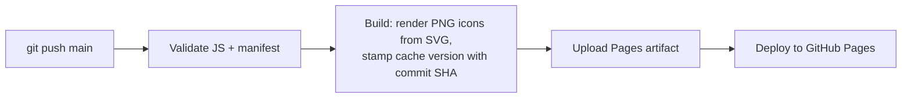

# Signal · Job Tracker PWA

An installable, offline-first **progressive web app** for tracking job applications. It's built with plain HTML, CSS and JavaScript (no framework) and **automatically built and deployed to GitHub Pages** by GitHub Actions on every push.

**Live app:** https://srikanthchinnala.github.io/signal-job-tracker/


## Features
- **Pipeline board**: Wishlist → Applied → Interview → Offer → Rejected, with drag and drop between stages
- **Dashboard stats**: totals, interviews, offers, response rate and follow-ups due
- **Follow-up reminders**: cards are flagged when a follow-up date has passed
- **Job board shortcuts**: one-click searches on LinkedIn, Indeed, Reed, Totaljobs, CWJobs and Glassdoor
- **Backup**: export and import your data as JSON
- **Installable and offline**: web app manifest plus a service worker with a versioned cache
- **Private**: data stays in the browser (`localStorage`), with no backend

## How it works
| File | Purpose |
|---|---|
| `index.html` | App shell |
| `app.js` | State, rendering, drag and drop, import/export, install prompt |
| `sw.js` | Cache-first service worker. The cache name is stamped with the commit SHA at build time |
| `manifest.webmanifest` | Name, colours and icons for installation |
| `.github/workflows/deploy.yml` | CI/CD: validate → build → deploy to GitHub Pages |

## CI/CD pipeline


1. **Validate**: `node --check` on all scripts and a JSON check on the manifest
2. **Build**: generates the 192px and 512px PNG icons from the SVG source and writes the commit SHA into the service-worker cache name, so users always get the latest version
3. **Deploy**: publishes `dist/` to GitHub Pages using the official Pages actions

## Run locally
```bash
python3 -m http.server 8080
# open http://localhost:8080
```
